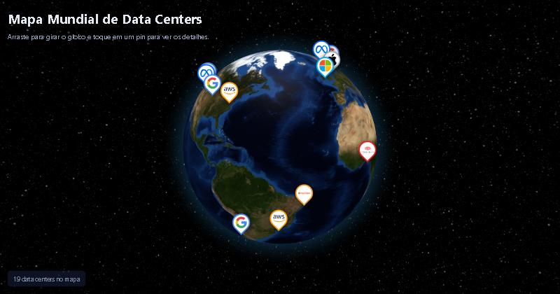
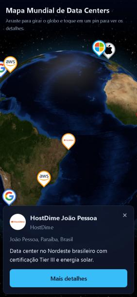

# 🌍 Mapa Mundial de Data Centers

Globo 3D interativo que mostra onde ficam alguns dos data centers mais importantes do mundo. Cada pin traz a logo da empresa. Ao tocar nele, aparece um resumo, e o botão **Mais detalhes** abre a história completa, com fotos e ficha técnica.

**🔗 Ver o site:** https://luizapleite.github.io/datacenters/



## Destaques

- **Globo 3D** com rotação, zoom e arraste, feito com [Globe.gl](https://globe.gl/).
- **19 data centers em 6 continentes**: Google, Meta, Microsoft, AWS, Apple, Equinix, Teraco, NEXTDC e HostDime.
- **Histórias verdadeiras**, escritas a partir de anúncios oficiais e notícias, com datas e números conferidos.
- **Imagens com licença livre** do Wikimedia Commons, todas com autor, licença e link para a fonte.
- **Funciona no celular**: o globo se ajusta à tela e o balão vira um painel na parte de baixo.
- Todo o conteúdo em **português do Brasil**.



## Tecnologias

| Camada | Uso |
|---|---|
| HTML, CSS e JavaScript | Interface, globo e página de detalhes |
| [Globe.gl](https://globe.gl/) (Three.js) | Renderização do globo 3D |
| PHP 8 + PDO | API (`api.php`) e página de detalhes (`detalhes.php`) |
| MySQL | Banco com as tabelas `empresas` e `datacenters` |

## Duas formas de rodar

O projeto funciona com **PHP + MySQL** (desenvolvimento local ou hospedagem com PHP) e também como **site estático** (GitHub Pages). O `js/app.js` tenta usar a API em PHP. Se ela não estiver disponível, passa a ler o arquivo `dados.json` e abre `detalhes.html` em vez de `detalhes.php`.

```
MySQL ──► api.php / detalhes.php        (com PHP)
  │
  └─► php exportar.php ──► dados.json ──► detalhes.html   (estático)
```

### Localmente, com Laragon (PHP + MySQL)

1. Clone o repositório dentro de `C:\laragon\www\` e inicie o Laragon.
2. Copie `.env.example` para `.env` e ajuste as credenciais do banco.
3. Crie e popule o banco:
   ```bash
   mysql -u root -e "CREATE DATABASE IF NOT EXISTS datacenters CHARACTER SET utf8mb4 COLLATE utf8mb4_unicode_ci"
   mysql -u root --default-character-set=utf8mb4 datacenters < database.sql
   ```
4. Acesse `http://datacenters.test`.

### Atualizando a versão estática

Depois de alterar o banco, gere o JSON de novo e faça commit:

```bash
php exportar.php
```

## Estrutura

```
├── index.html          Página do globo
├── detalhes.php        Detalhes (versão PHP)
├── detalhes.html       Detalhes (versão estática)
├── api.php             API JSON (listar / detalhe)
├── config.php          Lê o .env e cria a conexão PDO
├── exportar.php        Gera dados.json a partir do banco (só pelo terminal)
├── dados.json          Dados exportados para a versão estática
├── database.sql        Esquema e dados
├── css/style.css
├── js/app.js           Globo, pins e balão
├── js/detalhes.js      Monta a página de detalhes estática
└── img/
    ├── logos/          Logos das empresas
    ├── datacenters/    Fotos
    └── CREDITOS.md     Autor, licença e fonte de cada imagem
```

## Segurança

- As credenciais ficam no `.env`, que está no `.gitignore` e nunca vai para o repositório.
- Consultas com PDO e *prepared statements*; saída escapada com `htmlspecialchars` (PHP) e `textContent` (JavaScript).
- O `.htaccess` bloqueia acesso direto ao `.env` e ao `.sql` em servidores Apache.

## Créditos

- Fotos e logos: [Wikimedia Commons](https://commons.wikimedia.org/). A lista completa está em [img/CREDITOS.md](img/CREDITOS.md).
- As logos são marcas registradas de suas respectivas empresas. A licença livre cobre o arquivo de imagem, não o uso da marca. Teraco e NEXTDC usam marcadores provisórios.
- Texturas da Terra: exemplos do projeto [three-globe](https://github.com/vasturiano/three-globe).
- Os endereços das regiões de nuvem (AWS, por exemplo) não são públicos. Nesses casos a posição no mapa é aproximada.
